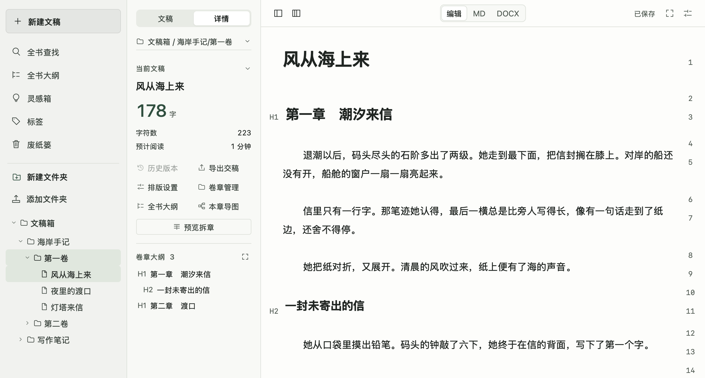
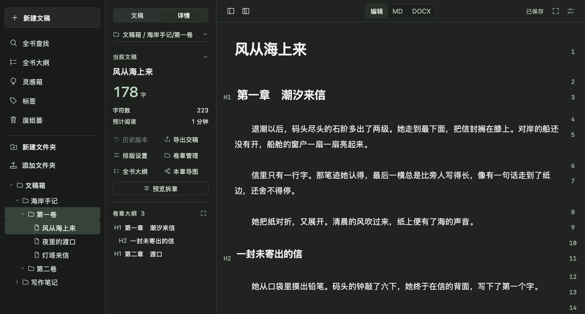

<strong>简体中文</strong> · <a href="README_EN.md" lang="en">English</a>

<h1 align="center">AresInk</h1>

用中文或英文写长篇，用 Word 交稿。

  
  
  
  
  

<a href="https://github.com/aresplus/aresink/releases/download/v1.0.0/AresInk-1.0.0-macOS-Universal.dmg"><strong>下载 macOS 版</strong></a> · <a href="https://github.com/aresplus/aresink/releases/download/v1.0.0/AresInk-1.0.0-Windows-x64-Setup.exe"><strong>下载 Windows 版</strong></a> · <a href="https://aressheng.com/products/aresink/"><strong>产品官网</strong></a>

AresInk 是一款支持中文和英文的离线 Markdown 长篇写作工具。书稿按卷章保存在自己的电脑上，打开「设置 → 界面语言」就能切换中文或 English。

写到第八十章，忽然想起一个只出现过一次的人名。用 AresInk 查整部书，点中那句话，就能回到当时的段落。交稿时，还是这份 Markdown 原稿：调好行距、段距和首行缩进，翻一遍分页预览，再把 DOCX 发给编辑。

## 写作界面

查看深夜主题

## 写作、修订与交稿

| 写长篇时 | AresInk 1.0.0 | 适用范围 |
| --- | --- | --- |
| 管理 100万–500万字的作品 | 按卷章组织，编辑器只绘制视口附近的内容；中文输入法组字时暂停自动滚动 | 字数是设计规模，60 fps 是输入与滚动目标 |
| 查一个姓、一个双字人名 | SQLite FTS5 配合中文单双字倒排索引，命中可跳回原句 | 索引就绪后，查询环节目标 < 2 ms；首次建索引、扫描及界面显示另计 |
| 改长段时保存 | 同目录临时文件写入、刷盘、核对指纹，再原子替换；发现外部冲突时保留磁盘原稿 | 保护已落盘版本；备份请复制含 `.novel` 的整个作品文件夹 |
| 离线续写 | 正文 100% 是本地 UTF-8 Markdown。可直接新建空白稿、建多级文件夹，也可挂载已有目录 | 写作、检索和保存均可断网，无需账号 |
| 整理与交稿 | 按 H1/H2 预览后无损拆章，规范中文引号和空行，重排章节号；按段调行距、段距、行宽 | 单篇或整部作品导出 MD、TXT、DOCX；macOS 另支持直接导出 PDF |

工作台提供中英双语、白天与深夜主题、专注模式和打字机模式。编辑端使用 React、TypeScript 和 CodeMirror 6，桌面端使用 Tauri 2、Rust 和 SQLite。性能目标取决于设备、章节结构及索引状态。

## 下载与安装

| 平台 | 适用设备 | 安装包 |
| --- | --- | --- |
| macOS | 13.3+ · Apple Silicon / Intel | [Universal DMG](https://github.com/aresplus/aresink/releases/download/v1.0.0/AresInk-1.0.0-macOS-Universal.dmg) |
| Windows | 10 / 11 · x64 | [x64 Setup EXE](https://github.com/aresplus/aresink/releases/download/v1.0.0/AresInk-1.0.0-Windows-x64-Setup.exe) |

[发布说明与 SHA-256](https://github.com/aresplus/aresink/releases/tag/v1.0.0) · [产品官网](https://aressheng.com/products/aresink/)

**macOS**　打开 DMG，把 AresInk 拖入「应用程序」，再从那里启动。AresInk 可在 Mac 上正常运行。当前版本采用临时签名，尚未经 Apple 公证，首次打开时若提示「无法验证开发者」，确认从本项目下载且 DMG 的 SHA-256 与发布页一致后，点「完成」，在「系统设置 → 隐私与安全性」找到 AresInk，点「仍要打开」并确认。若明确提示「已损坏」，先从本页重新下载并核对校验值；若仍提示损坏或恶意软件，请在 Issues 反馈。

**Windows**　开发者已在 Windows 电脑上实际安装并运行 AresInk 1.0.0。打开 EXE，选择安装目录。如果 SmartScreen 只提示「Windows 已保护你的电脑」，先核对发布页上的 SHA-256，再点「更多信息」核对文件名，确认后可点「仍要运行」。若 Defender 报告具体威胁，请停止并反馈。首次安装若缺少 WebView2，向导会联网获取它。

[Apple 首次打开说明](https://support.apple.com/zh-cn/102445) · [Microsoft SmartScreen](https://learn.microsoft.com/windows/security/operating-system-security/virus-and-threat-protection/microsoft-defender-smartscreen/)

## 常用快捷键

| 操作 | macOS | Windows |
| --- | --- | --- |
| 新建文稿 | ⌘ N | Ctrl + N |
| 新建文件夹 | ⌘ ⇧ N | Ctrl + Shift + N |
| 添加已有文件夹 | ⌘ ⇧ O | Ctrl + Shift + O |
| 查找当前文稿 | ⌘ F | Ctrl + F |
| 查找全书 | ⌘ ⇧ F | Ctrl + Shift + F |
| 切换专注模式 | ⌘ ⇧ J | Ctrl + Shift + J |
| 切换全屏 | ⌃ ⌘ F | F11 |

## 参与改进

写长篇时，哪一步最容易让你离开编辑器？欢迎在 [Issues](https://github.com/aresplus/aresink/issues/new/choose) 讲讲你的写作场景。如果 AresInk 帮你写完一章或交出一部书稿，也欢迎点个 **Star**，或把它分享给一起写作的朋友。

## 版权与致谢

版权所有 © 盛少。感谢 Tauri、Rust、React、TypeScript、CodeMirror 和 SQLite 的维护者。项目授权见 [LICENSE](LICENSE)，第三方组件沿用各自的许可。
