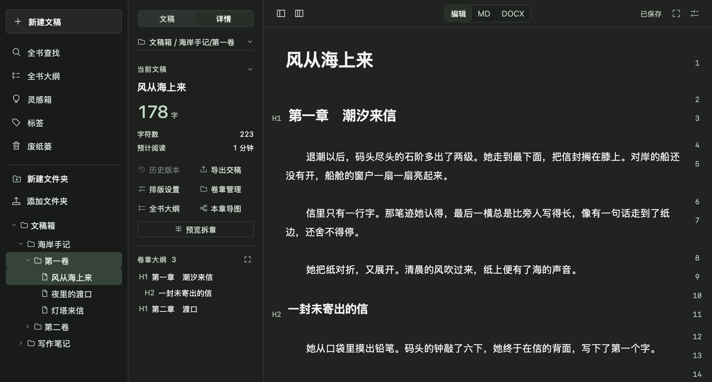

<a href="README.md" lang="zh-CN">简体中文</a> · <strong>English</strong>

<h1 align="center">AresInk</h1>

Write your book in English or Chinese. Deliver it in Word.

  
  
  
  
  

<a href="https://github.com/aresplus/aresink/releases/download/v1.0.0/AresInk-1.0.0-macOS-Universal.dmg"><strong>Download for macOS</strong></a> · <a href="https://github.com/aresplus/aresink/releases/download/v1.0.0/AresInk-1.0.0-Windows-x64-Setup.exe"><strong>Download for Windows</strong></a> · <a href="https://aressheng.com/products/aresink/"><strong>Website</strong></a>

AresInk is an offline Markdown workspace for writing long-form manuscripts in English or Chinese. Organize your book into chapters on your own computer. To switch the app interface, open **Settings → Interface language** and select **English** or **中文**.

Eighty chapters in, you remember a character who appeared only once. Search for their name, jump to the sentence, and pick up the thread. When your editor asks for Word, adjust the paragraph spacing, read through the page breaks, and export the same manuscript as DOCX.

## The workspace

View the night theme

## Drafting, revision, and delivery

| Task | AresInk 1.0.0 | Scope |
| --- | --- | --- |
| Edit a book of 1–5 million Chinese characters | Organize chapters into volumes. The editor renders near the viewport and pauses automatic scrolling during IME composition. | Design range; 60 fps is the typing and scrolling target. |
| Find a one-character surname or a two-character name | SQLite FTS5 and a dedicated one- and two-character Chinese index link each match to its sentence. | Target below 2 ms for a warm index lookup. Initial indexing, scanning, and UI rendering take additional time. |
| Save a revision | Write and flush a sibling temporary file, check the fingerprint, then replace the file atomically. External edit conflicts preserve the on-disk copy. | Back up the whole project folder, including `.novel`, to keep formatting and metadata. |
| Write offline | Manuscripts are 100% local UTF-8 Markdown. Start a blank page instantly, create nested folders, or mount an existing folder. | Writing, search, and saving work offline. No account required. |
| Prepare a submission | Preview a lossless H1/H2 split, normalize Chinese quotes and blank lines, renumber chapters, and tune paragraph spacing. | Export a manuscript or a whole book as MD, TXT, or DOCX. Direct PDF export is also available on macOS. |

The bilingual Chinese/English workspace includes day and night themes, focus mode, and typewriter scrolling. Built with Tauri 2, Rust, React, TypeScript, CodeMirror 6, and SQLite. Performance depends on hardware, chapter structure, and index state.

## Download and install

| Platform | Requirements | Installer |
| --- | --- | --- |
| macOS | 13.3+ · Apple Silicon / Intel | [Universal DMG](https://github.com/aresplus/aresink/releases/download/v1.0.0/AresInk-1.0.0-macOS-Universal.dmg) |
| Windows | 10 / 11 · x64 | [x64 Setup EXE](https://github.com/aresplus/aresink/releases/download/v1.0.0/AresInk-1.0.0-Windows-x64-Setup.exe) |

[Release notes and SHA-256 checksums](https://github.com/aresplus/aresink/releases/tag/v1.0.0) · [Product website](https://aressheng.com/products/aresink/)

**macOS.** Open the DMG, drag AresInk to Applications, and launch it there. AresInk runs on macOS. This build is ad hoc signed and has not been notarized by Apple, so you may see a developer verification warning on first launch. For an unidentified-developer warning, verify the download source and DMG checksum, dismiss the alert, then choose **System Settings → Privacy & Security → Open Anyway** for AresInk. For a damaged-app alert, download a fresh copy and verify its checksum. Report persistent damage or a malware alert in Issues.

**Windows.** The developer installed and ran AresInk 1.0.0 on a Windows PC. Run the EXE and choose an install location. For a SmartScreen reputation warning, verify the EXE checksum, select **More info**, check the filename, and choose **Run anyway** if you trust the release. Stop and report a specific Defender threat detection. The installer may need internet access once if WebView2 is missing.

[Apple’s guide](https://support.apple.com/en-us/102445) · [Microsoft SmartScreen](https://learn.microsoft.com/windows/security/operating-system-security/virus-and-threat-protection/microsoft-defender-smartscreen/)

## Keyboard shortcuts

| Action | macOS | Windows |
| --- | --- | --- |
| New manuscript | ⌘ N | Ctrl + N |
| New folder | ⌘ ⇧ N | Ctrl + Shift + N |
| Mount a folder | ⌘ ⇧ O | Ctrl + Shift + O |
| Find in manuscript | ⌘ F | Ctrl + F |
| Find in book | ⌘ ⇧ F | Ctrl + Shift + F |
| Toggle focus mode | ⌘ ⇧ J | Ctrl + Shift + J |
| Toggle full screen | ⌃ ⌘ F | F11 |

## Feedback

What makes you leave the editor when you work on a long manuscript? [Tell us about your workflow](https://github.com/aresplus/aresink/issues/new/choose). If AresInk helped you finish a chapter or deliver a book, give it a **Star** or pass it along to another writer.

## Copyright and acknowledgments

版权所有 © 盛少 (Sheng Shao). Thanks to the maintainers of Tauri, Rust, React, TypeScript, CodeMirror, and SQLite. See [LICENSE](LICENSE) for project terms. Third-party components retain their respective licenses.
